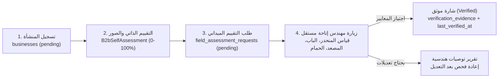

# مواصفات لوحة تحقق الأعمال — ONEWAY B2B Verification & Business Portal Spec

> **النسخة:** 1.0 • **النظام:** ONEWAY — مصر بدون عوائق (Flutter + Firebase)
> **التنفيذ البرمجي المرتبط:** [`lib/features/business/b2b_portal_models.dart`](../lib/features/business/b2b_portal_models.dart), [`lib/features/business/b2b_verification_dashboard.dart`](../lib/features/business/b2b_verification_dashboard.dart), [`lib/pages/business_admin_dashboard/business_admin_dashboard_widget.dart`](../lib/pages/business_admin_dashboard/business_admin_dashboard_widget.dart)

---

## 1. الهدف والقاعدة الذهبية (Ethical Integrity Charter)

توفّر بوابة أعمال ONEWAY للمنشآت المصرية (المستشفيات، المولات، الفنادق، المطاعم، الجامعات، البنوك، والهيئات الحكومية) منصة احترافية لـ:
1. **التوثيق الميداني المستقل للإتاحة الحركية** المتوافق مع الكود المصري وقانون رقم 10 لسنة 2018.
2. **قياس التوافق حسب نوع الحركة** (كرسي كهربائي، يدوي، كبار السن، عربات أطفال).
3. **إدارة الفروع وبلاغات العوائق** والرد على تقييمات المجتمع.
4. **الاشتراكات المؤسسية (B2B SaaS)** مع فصل تام بين الاشتراك المدفوع وشارة التحقق.

> **ميثاق النزاهة غير القابل للتفاوض (`grantsBadgeOnPayment == false`):**
> الاشتراك المدفوع يمنح المنشأة **أدوات التحليلات والإدارة والتقارير فقط**. **شارة "موثّق" (`Verified`) لا تُباع أبداً**، ولا تظهر على أي فرع في التطبيق إلا إذا تحقّق الشرط البرمجي `isGenuinelyVerified == (verification_status == 'verified' && verification_evidence.trim().isNotEmpty)` بعد زيارة مهندس إتاحة مستقل.

---

## 2. الأدوار والصلاحيات (RBAC)

| الدور (`users.role`) | الصلاحيات في بوابة الأعمال | القاعدة الحاكمة في `firestore.rules` |
| --- | --- | --- |
| `user` | تقديم طلب تسجيل منشأة (`status: 'pending'`, `subscription_tier: 'free'`) | إنشاء فقط في `businesses` |
| `businessOwner` | قراءة وتعديل بيانات منشأته (دون `status`/`ownerId`), تقديم طلب تقييم ميداني في `field_assessment_requests`, قراءة اشتراكه في `subscriptions`, عرض فروع منشأته | `isBusinessOwnerOf(businessId)` |
| `moderator` | مراجعة طلبات التقييم الميداني، تحديث `places.verification_status` وإضافة `verification_evidence`, الرد على بلاغات `accessibilityReports` | `isModerator()` |
| `admin` / `superAdmin` | تعيين دور `businessOwner` عبر Cloud Function موثوقة، مراجعة `auditLogs`, إدارة الاشتراكات المؤسسية | `isAdmin()` / `isSuperAdmin()` |

---

## 3. مسار التوثيق الميداني (4-Stage Verification Pipeline)



### متطلبات دليل التوثيق (`places.verification_evidence`)
لا يُقبل اعتماد فرع إلا بتوثيق نصي ومرجعي واضح يشمل:
- اسم المهندس / الفريق الميداني وتاريخ الزيارة.
- قياسات فعلية: عرض المدخل (سم)، زاوية ميل المنحدر (مثلاً `≤ 1:12`)، عرض باب المصعد (سم)، أبعاد دورة المياه المجهزة ومقابض الأمان، ومواقف السيارات المخصصة.
- صور تفصيلية مخزنة في `entrance_photo_url`, `elevator_photo_url`, `restroom_photo_url`.

---

## 4. مؤشرات الأداء والتحليلات (B2B Analytics Dashboard)

| المؤشر | المصدر | الغرض لصاحب المنشأة |
| --- | --- | --- |
| نسبة التوافق حسب نوع الحركة | `AccessibilityScorer` على `places.accessibility_features` | كشف الفجوات (مثلاً: ملائم للعربات 85% لكن للكرسي الكهربائي 55% بسبب منحدر شديد الميل) |
| عدد الفروع الموثّقة vs غير الموثّقة | `places` حيث `business_id == businessId` | متابعة التقدم في تغطية السلسلة بالكامل |
| مشاهدات المكان والنقر على الاتجاهات | Firebase Analytics (`place_viewed`, `navigation_started`) | إثبات العائد الاستثماري (ROI) لجذب شريحة جديدة من الزوار |
| بلاغات العوائق وزمن الاستجابة (SLA) | `accessibilityReports` المرتبطة بالفروع | حل الأعطال (مثل تعطل المصعد) بسرعة وحماية سمعة المنشأة |
| متوسط تقييم الإتاحة المجتمعي | `reviews` حيث `status == 'published'` | قياس رضا الزوار من ذوي الإعاقة وأسرهم |

---

## 5. هيكل الباقات والتسعير (Monetization Architecture)

| الباقة | السعر (ج.م) | السعر التقريبي ($) | أبرز الميزات |
| --- | --- | --- | --- |
| **Free (الأساسية)** | 0 ج.م | \$0 | إدراج فرع واحد، عرض تقييم الإتاحة الأساسي، قائمة التقييم الذاتي التفاعلية |
| **Field Audit (التقييم الميداني)** | 5,000 ج.م / فرع (مرة واحدة) | ~\$100 | زيارة هندسية، قياسات دقيقة، تقرير امتثال قانون 10/2018، توثيق `verification_evidence` ومنح الشارة عند الاجتياز |
| **Business Pro** | 1,000 ج.م / شهر (أو 10,000 / سنة) | ~\$20/شهر | تحليلات متقدمة حسب نوع الحركة، حتى 10 فروع، تنبيهات فورية للبلاغات، الرد الرسمي على التقييمات، تصدير تقارير |
| **Enterprise / B2G** | تسعير مخصص | \$2,000–\$15,000 / سنة | فروع غير محدودة، فريق تدقيق مخصص، إعادة توثيق ربع سنوية، تكامل API، لوحات متابعة لوزارات وهيئات السياحة |

### قاعدة كتابة الاشتراكات (`subscriptions`)
تظل مجموعة `subscriptions` محمية بقاعدة `allow write: if false;` في `firestore.rules`؛ يتم إنشاء وتحديث الاشتراكات حصرياً من الخلفية (Cloud Functions + بوابة دفع مصرية مثل Paymob / Fawry / Stripe) لضمان منع أي تلاعب من جهة العميل.

---

## 6. مخطط البيانات (Firestore Contract)

### `field_assessment_requests/{requestId}`
```json
{
  "owner_id": "uid_of_business_owner",
  "business_id": "businesses_doc_id",
  "business_name": "مستشفى دار الفؤاد",
  "status": "pending",
  "readiness_percent": 85,
  "self_assessment": {
    "wheelchair_entrance": true,
    "ramp": true,
    "suitable_elevator": true,
    "accessible_restroom": true,
    "accessible_parking": false,
    "has_facility_photos": true,
    "corridor_width_note": "160 cm",
    "readiness_percent": 85
  },
  "created_at": "Timestamp"
}
```

### `subscriptions/{subscriptionId}`
```json
{
  "ownerId": "uid_of_business_owner",
  "businessId": "businesses_doc_id",
  "planId": "pro",
  "status": "active",
  "provider": "paymob",
  "providerReference": "ord_123456",
  "currentPeriodStart": "Timestamp",
  "currentPeriodEnd": "Timestamp"
}
```
